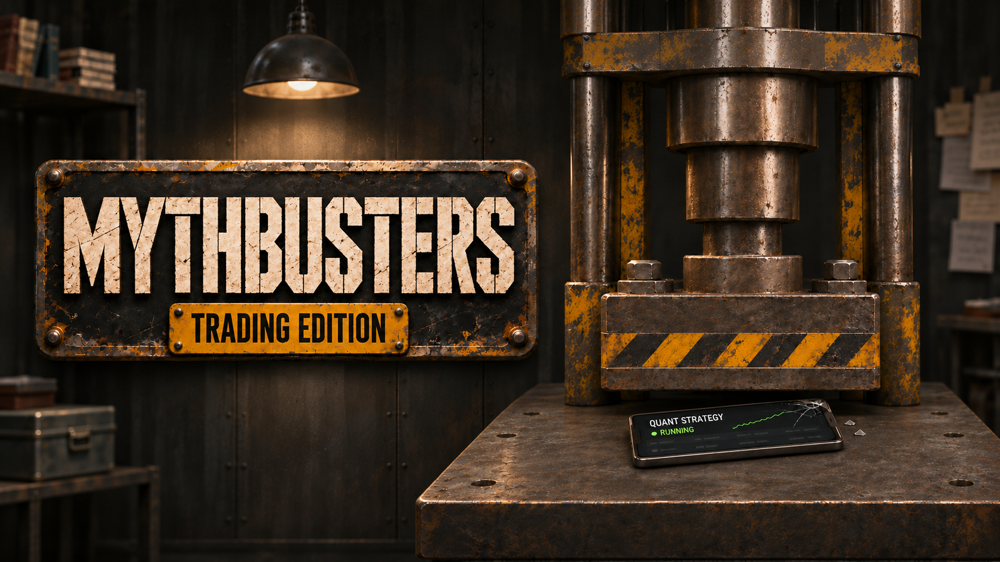

# MythBusters: Trading Edition

[简体中文](README.zh-CN.md)

**Your feed says it works. Does the backtest agree?**

We take trading methods circulating on social media, turn their claims into rules we can test, and publish the evidence so readers can rerun the backtest and see what drives the result.

Each case starts with the original post and a testable claim. We document how signals become trades, the data source and period, fees and slippage assumptions, and the pass criteria. The report shows the net result, drawdown, and benchmark when relevant. The verdict applies to the claim under the tested conditions.

## Backtest log

| Source | Backtest data and code | Backtest results | Verdict |
| --- | --- | --- | --- |
| — | — | No backtests published yet. | — |

Each completed case gets a verdict stamp in the last column.

| Stamp | What it means |
| --- | --- |
|  | The evidence supports the claim under the stated test conditions. |
|  | The results contradict the claim under the stated test conditions. |
|  | The available evidence cannot settle the claim. |
