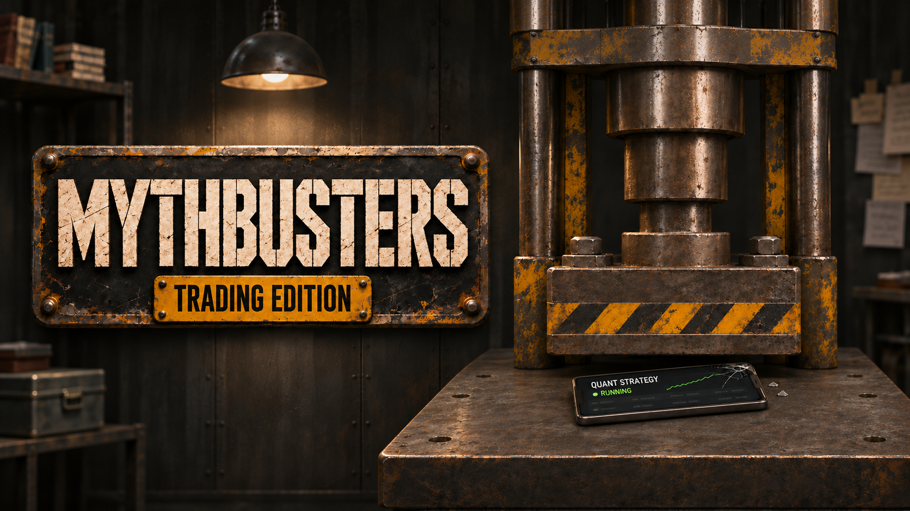

# 流言终结者-交易版

[English](README.md)

**社交媒体上都说这招有效。放进回测里，还成立吗？**

我们把社交媒体上流传的交易方法写成可以执行和检验的规则，公开原帖、回测数据来源、代码和结果，让读者能自己复跑，看看结论是怎么得出的。

每个案例从原帖和一条可检验的主张出发，记录信号何时触发、交易如何执行、数据来源与样本区间、费用和滑点假设，以及预先设定的判定标准。报告给出扣除交易成本后的结果、回撤，并在适用时提供对照基准。结论适用于该次回测所列的条件。

## 回测记录

| 来源 | 回测数据和代码 | 回测结果 | 最终结论 |
| --- | --- | --- | --- |
| — | — | 暂无已发布的回测。 | — |

完成的案例会在最后一列盖上判定章。

| 印章 | 含义 |
| --- | --- |
|  | 在所列回测条件下，证据支持原主张。 |
|  | 在所列回测条件下，结果与原主张相矛盾。 |
|  | 现有证据不足以判定真假。 |
